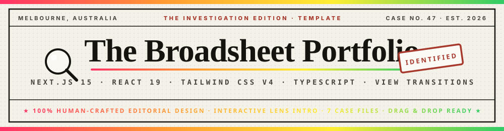
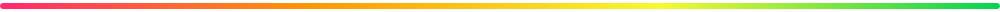
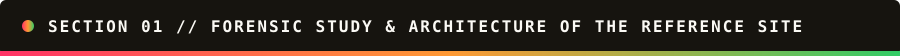
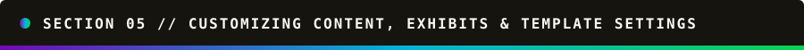

<div align="center">



<br />


<p align="center">
  <b>An investigative broadsheet newspaper developer portfolio &amp; case-file archive.</b><br />
  <i>Hand-set in Libre Caslon Display, Libre Caslon Text, Libre Franklin &amp; JetBrains Mono — featuring an interactive magnifying-glass "Wanted" hunt intro, custom lens cursor, darkroom photo-develop scroll reveals, distressed ink stamps, and 7 full investigative case files.</i>
</p>

</div>



<br />



### 🕵️‍♂️ Complete Study of the Reference Broadsheet Architecture

Before writing a single line of code, the reference broadsheet portfolio was inspected across every stylesheet chunk, React Server Component payload, font binary, SVG filter, and interactive state machine:

| Layer                        | Exact Technical Specification                                                                                                                                 | Implementation in This Repo                                                                                    |
| :--------------------------- | :------------------------------------------------------------------------------------------------------------------------------------------------------------ | :------------------------------------------------------------------------------------------------------------- |
| **Framework**                | **Next.js App Router** (SSR + SSG dynamic routes + API Route Handler)                                                                                         | `src/app/layout.tsx`, `src/app/page.tsx`, `src/app/case-files/[slug]/page.tsx`, `src/app/api/contact/route.ts` |
| **Styling Engine**           | **Tailwind CSS v4** (`@import "tailwindcss";` + `@theme` tokens + custom editorial rules)                                                                     | `src/app/globals.css` + `postcss.config.mjs`                                                                   |
| **Typography**               | **Libre Caslon Display** (headlines), **Libre Caslon Text** (body & italics), **Libre Franklin** (gothic kickers/stamps), **JetBrains Mono** (codes & tags)   | Self-hosted `.woff2` binaries in `public/fonts/` with zero external network latency                            |
| **Color Palette**            | Warm newsprint paper (`#f4f1e9`, `#efeadd`, `#e7e0cf`, `#fbfaf5`), deep press ink (`#16140f`, `#45413a`, `#8b8678`), crimson ink stamp (`#a6382c`, `#c9503f`) | CSS custom properties in `@theme` (`bg-paper`, `text-ink`, `text-stamp`, etc.)                                 |
| **Paper Grain & Ink Filter** | Fixed multiply vignette/scanline overlay on `body::before` + global SVG `<filter id="fm-rough">` (`feTurbulence` + `feDisplacementMap`)                       | `src/app/globals.css` & `src/app/layout.tsx`                                                                   |
| **Content & Tone**           | Dry, deadpan investigative journalism (_"The Investigation Desk"_, _"Case No. 47"_, _"Exhibits A–G"_, _"Forensics — The Lab Report"_, _"Known Whereabouts"_)  | Recreated around **Julian Vance** (_The Julian Vance Chronicle_, Melbourne) in `src/lib/data.ts`               |

<br />


<br />


### ✨ Every Single Animation, Button, Cursor & Micro-Interaction Included

1. **🔍 Interactive Magnifying-Glass "Wanted" Hunt Intro (`src/components/Intro.tsx`)**
   - Fullscreen fixed broadsheet newspaper scene with 5 blurred columns (_The Morning Brief_, _Notes from the Desk_, _Field Report_, _Late Edition_, _On the Record_) and a central **WANTED** masthead.
   - A 3D-styled magnifying lens (`1.9x` optical zoom inside `.fm-magwin`, rim highlights, angled handle, spotlight radial gradient, and film grain) tracks the cursor with `0.12` spring damping and gentle auto-drift after 3 seconds of idle time.
   - Hovering over the subject in the center for `250ms` locks the lens (`locked` state), triggers a high-frequency camera shake tremor, flashes a bright sheet, slams down the distressed crimson **`IDENTIFIED`** stamp (`#fm-rough`), sets the `rt_intro_seen=1` cookie, and reveals the front page.
   - Includes a **`Skip intro →`** button (plus `Escape` key support) and a footer **Fingerprint (`Reopen the case`)** button (`src/components/ReopenCase.tsx`) that clears the cookie and replays the intro anytime.

2. **🕵️ Custom Magnifying Lens Cursor (`src/components/LensCursor.tsx`)**
   - Tracks pointer movement (`translate(X+12px, Y+14px)`) and smoothly fades in (`opacity: 1`) whenever hovering over any interactive element (`a`, `button`, `[data-lens]`).

3. **🎞️ Scroll-Triggered Darkroom & Editorial Reveal System (`src/components/Reveal.tsx`)**
   - Powered by a shared `IntersectionObserver` (`threshold: 0.15, rootMargin: "0px 0px -10% 0px"`) synchronized with the `rt-intro-done` event:
     - `rv-settle`: Smooth cubic-bezier(`0.22, 1, 0.36, 1`) upward settle + fade.
     - `rv-develop`: Darkroom photograph develop transition (`blur(5px) contrast(1.35)` → crisp grayscale print with `mix-blend-multiply`).
     - `rv-rule`: Horizontal broadsheet rule wipe (`scaleX(0)` → `scaleX(1)`).
     - `rv-word`: Staggered word-by-word headline rise (`40ms` per word).
     - `rv-sketch`: Hand-drawn red grease-pencil SVG circle (`stroke-dashoffset: 1` → `0`) around **Exhibit A – Exhibit G**.
     - `rv-stampchild`: Spring-physics stamp pop-in (`scale(1.5) rotate(-6deg)` → settled angle).

4. **🖍️ Hand-Drawn Wavy Red Pencil Underlines & Polaroid Tape Frames**
   - `.link-pencil` and `.link-pencil-bright` animate an inline SVG wavy red stroke from `0% 5px` to `100% 5px` on hover.
   - Exhibit cards feature a translucent masking-tape strip at the top (`-top-2 -rotate-2`), crimson halftone dot-matrix overlay on hover, and a rotated **`CONFIRMED`** stamp.

5. **📁 7 Complete Case File Pages (`/case-files/[slug]`) + Custom 404 Public Notice**
   - Clicking **`Open case file →`** on any of Exhibits A–G opens its dedicated investigative report with a 2:1 taped figure, 2-column newspaper body with `.dropcap`, full-span pull-quote, **`How it was built`** forensic spec table, and related exhibits.
   - Visiting any unknown route renders the **`Missing Person — 404`** broadsheet notice (`src/app/not-found.tsx`).

<br />


<br />


### 🖥️ How Can I See the Preview?

#### 1. Viewing the Live Preview Right Now (In-App Preview)

- The **Website** dev server is already running in this workspace on port `3000` (`0.0.0.0:3000`).
- Click the **Live Preview / Website** panel in the UI to interact with the live application immediately:
  - Move your mouse (or drag on touch devices) during the **Wanted** intro to hunt for the subject with the magnifying glass, or click **`Skip intro →`** in the top-right corner.
  - Scroll through the Front Page, hover over **Exhibits A–G** to see the red halftone + **`Confirmed`** stamp + custom lens cursor, click **`Open case file →`** to read any of the 7 full case reports, test the **Letters & Commissions** form, or click the **Fingerprint icon** in the bottom-right footer to replay the magnifying-glass intro!

#### 2. Running Locally on Your Computer

```bash
# 1. Install dependencies
npm install

# 2. Start the development server on http://localhost:3000
npm run dev

# 3. Build for production
npm run build && npm start
```

<br />


<br />


#### 📂 Clean File & Folder Structure (Only 31 Source Files!)

Because `.gitignore` excludes `node_modules/` and `.next/`, the entire clean source repository contains **only 31 files** (well under GitHub's 100-file web upload limit!):

```text
broadsheet-developer-portfolio-template/
├── .gitignore                          # Excludes node_modules, .next, .env, build artifacts
├── README.md                           # This rainbow-animated documentation & guide
├── next.config.ts                      # Next.js configuration
├── package.json                        # Scripts & dependencies (Next 15, React 19, Tailwind v4)
├── package-lock.json                   # Deterministic dependency lockfile
├── postcss.config.mjs                  # Tailwind CSS v4 PostCSS plugin
├── tsconfig.json                       # TypeScript configuration
├── public/
│   ├── manifest.webmanifest            # Web app manifest
│   ├── fonts/                          # 6 self-hosted .woff2 fonts (Caslon, Franklin, JetBrains Mono)
│   ├── images/                         # Custom woodcut portrait + 7 Exhibit UI screenshots
│   └── readme/                         # 7 animated SVG banners & dividers for README.md
└── src/
    ├── app/
    │   ├── globals.css                 # Broadsheet theme tokens, animations & magnifying-glass styles
    │   ├── icon.svg                    # Broadsheet "JV" favicon
    │   ├── layout.tsx                  # Root layout, LensCursor & #fm-rough SVG filter
    │   ├── not-found.tsx               # Custom 404 "Missing Person" public notice
    │   ├── page.tsx                    # Front Page, Exhibits A–G, Lab Report, Career Ledger & Footer
    │   ├── api/contact/route.ts        # Contact form POST endpoint
    │   └── case-files/[slug]/page.tsx  # Dynamic Case File pages for Exhibits A–G
    ├── components/
    │   ├── Button.tsx                  # Primary, ink & ghost broadsheet buttons
    │   ├── Contact.tsx                 # Letters & Commissions form + desk details
    │   ├── DateLine.tsx                # 600ms rAF typewriter dateline
    │   ├── Icons.tsx                   # Phosphor SVG icons (GitHub, LinkedIn, MapPin, Fingerprint, etc.)
    │   ├── Intro.tsx                   # Interactive magnifying-glass "Wanted" hunt intro
    │   ├── LensCursor.tsx              # Custom floating magnifying-glass cursor
    │   ├── ReopenCase.tsx              # Footer fingerprint button to replay the intro
    │   ├── Reveal.tsx                  # Scroll-triggered IntersectionObserver animations
    │   ├── Shell.tsx                   # Responsive max-width container
    │   └── SiteNav.tsx                 # Sticky broadsheet navigation & mobile drawer
    └── lib/
        └── data.ts                     # Single-file configuration for persona, 7 exhibits, stack & career
```

---

<br />


<br />



### 🛠️ How to Customize Content, Pictures & Persona in 2 Minutes

All personal details, links, exhibits, tech stack rows, and career history live in **one single file**: **`src/lib/data.ts`**.

1. **Change Name, City & Social Links (`src/lib/data.ts`)**:
   ```ts
   export const SUBJECT_NAME = "Julian Vance";
   export const PAPER_NAME = "The Julian Vance Chronicle";
   export const CONTACT_EMAIL = "julian@studio47.com.au";
   export const GITHUB_URL = "https://github.com/julianvance";
   export const LINKEDIN_URL = "https://www.linkedin.com/in/julian-vance-dev/";
   export const CITY_FULL = "Melbourne, Australia";
   export const CASE_NUMBER = "47";
   ```
2. **Swap Portrait & Project Screenshots (`public/images/`)**:
   - Replace `public/images/julian-portrait.png` with your own portrait (a black-and-white ink/halftone illustration on a white background blends seamlessly into the newsprint via `mix-blend-multiply`).
   - Replace the 7 exhibit screenshots in `public/images/` and update their metadata in the `EXHIBITS` array in `src/lib/data.ts`.
3. **Update Tech Stack & Career Ledger (`src/lib/data.ts`)**:
   - Edit `LAB_SUBSTANCES` to change your tools and stamp findings (`Primary tool`, `Comfortable`, `In training`, `Trace amount`).
   - Edit `CAREER_LEDGER` to update your work history timeline.

<br />


<div align="center">
  <br />
  <b>© 2026 The Julian Vance Chronicle · Hand-set in Caslon &amp; Franklin · Built with Next.js &amp; Tailwind CSS</b>
</div>

<div align="center">
## 🌟 Support the Project

If you find this template useful, please consider giving it a star! It helps others discover the repository and supports future development.

---

</div>
